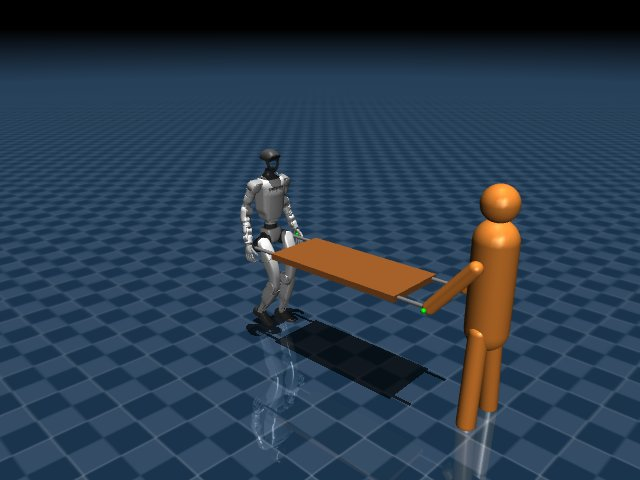

# G1 協調搬送 — MuJoCo

人間役とUnitree G1が荷物の両端を持ち、力のやり取りに応じて一緒に運ぶ研究用シミュレーションです。

**ブランチ：`cooperative-carry/mujoco` ／ 状態：MuJoCoで動作確認済み**

[人間追従](https://github.com/okome88/G1-dev-master-thesis/tree/main) · [Isaac Lab開発版](https://github.com/okome88/G1-dev-master-thesis/tree/cooperative-carry/isaaclab) · [ブランチ一覧](BRANCHES.md)



## できること

- 自動軌道またはキーボードで人間役を操作。
- 荷物の重量・寸法、速度、把持の剛性、制御ゲインを設定ファイルで変更。
- 人間モデル、上位制御、歩行方策、シーンを個別に拡張。
- GUIなしの評価、動画・CSV・JSONの出力。

MuJoCoと公式G1 ONNXを使用します。CUDA、ROS 2、ゲームパッド、C++ビルドは不要です。

## クイックスタート

Python 3.11〜3.13、Git、uvを用意してください。Windows / Ubuntuを対象とし、表示にはOpenGL環境が必要です。

```bash
git clone --branch cooperative-carry/mujoco https://github.com/okome88/G1-dev-master-thesis.git g1-carry-mujoco
cd g1-carry-mujoco
uv sync --frozen --extra dev --extra video
uv run --frozen --extra video g1-carry fetch-assets
uv run --frozen --extra video g1-carry run --config configs/carry_g1.toml --viewer
```

初回だけ固定版のG1形状を取得してハッシュを照合します。

### 人間役をキーボードで操作

```bash
uv run --frozen --extra video g1-carry run --config configs/carry_g1.toml --viewer --keyboard
```

W/Sで前後、A/Dで横方向の目標速度を変更し、スペースで停止します。キーを離しても速度は維持されます。

## 実験と記録

| 設定 | 内容 |
|---|---|
| `configs/carry_g1.toml` | 0.5 kgの荷物を直進搬送 |
| `configs/carry_curve.toml` | 横方向の変化を含む軌道 |
| `configs/carry_stop.toml` | 人間の停止への応答 |
| `configs/walk_g1.toml` | 荷物なしの歩行診断 |
| `configs/carry_surrogate.toml` | 平面代理モデルによる力学テスト |

```bash
# GUIなしでログを保存。出力先は新しいフォルダを指定
uv run --frozen g1-carry run --config configs/carry_g1.toml --output results/my-run

# 動画・開始時の画像
uv run --frozen --extra video g1-carry run --config configs/carry_g1.toml --video --snapshot

# 自動テスト
uv run --frozen --extra dev python -m pytest -q
```

## ドキュメント

| 資料 | 内容 |
|---|---|
| [構築・実行手順](docs/COOPERATIVE_CARRY.md) | 設定、操作、ログ、トラブル時の確認 |
| [拡張設計](docs/CARRY_ARCHITECTURE.md) | 人間・制御・方策・シーンの追加方法 |
| [検証記録](docs/CARRY_VALIDATION.md) | 条件と測定結果 |
| [初期設計案](COOPERATIVE_CARRY_PLAN.md) | 開発方針と今後の計画 |
| [公式モデル](models/README.md) | 重み・設定・配布元・ライセンス |

## 検証と制限

Windowsでの実行・描画とUbuntu CIを確認しています。0.5〜2 kgの設定で1.5 m搬送した記録がありますが、各条件の決定論的な動作確認です。

人間は簡略モデル、把持はばね・ダンパーで表現しています。指による把持、床からの持ち上げ、荷物の向きを変える旋回協調、実機での運搬性能は対象外です。詳細は[検証記録](docs/CARRY_VALIDATION.md)を参照してください。
