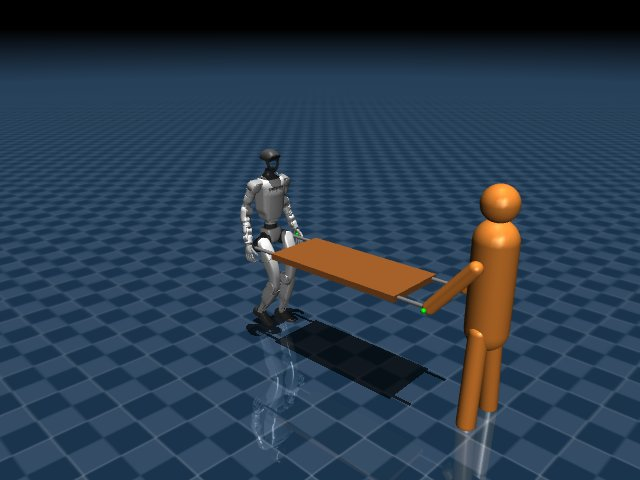

# 人間とG1の協調搬送: 環境構築と実行

## この版でできること



- 29関節G1、自由剛体の荷物、人間役の有限力モデルを同一MuJoCo世界で計算。
- 人間の直進、横方向の周期的な動き、開始・停止、キーボード操作。
- 手先にかかる力を移動指令へ変換するアドミッタンス制御。
- 荷重・寸法・接続剛性・人間の速度・制御ゲインをTOMLで変更。
- GUIなし評価、ビューアー、動画、CSVとJSONの記録。
- G1を使わない軽量な平面代理モデルによる力学・制御テスト。

G1は既存の公式ONNXを使用。COLAのモデルは組み込んでいません。公開COLA実行経路の入力は荷物なし条件に制限され、単純な差し替えが不適切なためです。

## 必要なもの

Python 3.11〜3.13（検証: 3.12.10）、uv、Git。WindowsまたはUbuntuを対象とします。
CPU版MuJoCoとONNX Runtimeで動くため、この初版はCUDA・mjlab・ROS 2を必要としません。
GUI・動画にはOpenGL環境が必要です。サーバーでのGUIなし評価は描画不要です。

既存のmjlab学習環境は更新せず、このリポジトリの`.venv`に分離します。

```bash
git clone https://github.com/okome88/unitree-g1-human-follow.git
cd unitree-g1-human-follow
uv sync --frozen --extra dev --extra video
uv run --frozen --extra video g1-carry fetch-assets
```

既にclone済みなら、そのフォルダで更新してから最後の2行を実行します。
アセットは公式リポジトリの固定コミットから取得し、Git blob SHAを照合します。
通常のシミュレーション実行時にダウンロードは発生しません。

## 起動

以下はリポジトリ直下から実行します。パスは作業ディレクトリを基準に解決します。

```bash
# G1と人間役の自動搬送
uv run --frozen --extra video g1-carry run --config configs/carry_g1.toml --viewer

# 人間役をキーボードで操作
uv run --frozen --extra video g1-carry run --config configs/carry_g1.toml --viewer --keyboard

# 再現可能なGUIなし実験
uv run --frozen g1-carry run --config configs/carry_g1.toml --output results/my_run

# 動画と開始時のスクリーンショット
uv run --frozen --extra video g1-carry run --config configs/carry_g1.toml --video --snapshot

# 無負荷歩行の診断
uv run --frozen g1-carry run --config configs/walk_g1.toml

# G1アセットが不要な力学テスト用代理モデル
uv run --frozen g1-carry run --config configs/carry_surrogate.toml --viewer
```

キーボードはビューアーを選択してW/Sで前後速度、A/Dで横速度を0.05 m/sずつ変更します。
スペースで人間の目標速度を0にします。キーを離しただけでは速度は0になりません。
ウィンドウを閉じると実行を終了します。MuJoCoの表示一時停止キーは使わず、停止にはスペースかウィンドウ終了を使ってください。

`--duration 10`で実験時間の上限を変更できます。目標到達・転倒・落下・把持点の離れ・過大傾斜でも終了します。
既存の結果フォルダは上書きせずエラーにします。別名を選ぶか、`--output`を省略してください。

## 設定ファイル

|ファイル|内容|
|---|---|
|`configs/carry_g1.toml`|0.5 kg、直進、1.5 mの到達目標|
|`configs/carry_curve.toml`|横方向の変化を含む軌道。ロボットの向き変更は行わない|
|`configs/carry_stop.toml`|6秒で人間が停止し、15秒まで応答を観察|
|`configs/walk_g1.toml`|荷物なしの0.15 m/s歩行|
|`configs/carry_surrogate.toml`|平面支持された代理モデル。二足歩行ではない|

例えば荷物の変更は設定をコピーし、`[payload]`の`mass`を変更します。
形状は長さ`length`、厚さ`thickness`、ハンドル長`handle_length`を変更できます。
荷重・剛性を大きくすると転倒・数値不安定を起こし得ます。失敗も実験結果として記録されます。

## 結果

- `metadata.json`: 設定、依存ライブラリの版、Gitコミット・未コミット変更の有無、方策ハッシュ。
- `trajectory.csv`: 時刻、移動量、荷物傾斜、水平操作力、鉛直支持力、把持点誤差、指令速度。
- `summary.json`: 終了理由、到達判定、最大傾斜、操作力RMS。
- `rollout.mp4` / `preview.png`: オプション指定時のみ。

`success`は距離目標への到達のみを指します。歩行診断や停止試験の`time_limit`は、その時間まで終了条件に触れなかった意味です。
`seed`は将来のランダム化用に保持しますが、現在の標準場面は決定論的です。seedだけ変えても独立した実験条件にはなりません。

## テスト

```bash
uv run --frozen --extra dev python -m pytest -q

# 重量・軌道・停止・物理刻みの比較
uv run --frozen python scripts/benchmark_carry.py
```

アセットがなければG1結合テストは明示的にskipされます。GitHub Actionsでは取得後にG1試験も実行します。
テストは力の向き・上限、座標変換、重力支持、resetの再現性、代理モデルの搬送、G1歩行・搬送を確認します。

## 制限

人間は全身動力学のある歩行者ではなく、視覚用アバターと手先インピーダンスです。人間の力の反作用は外部の人間モデルが受ける扱いです。
把持は有限剛性のばね・ダンパーで理想化し、指の接触や摩擦把持は学習していません。
ハンドルは質量なし・非接触の表示で、力は設定した把持点に伝わります。ロボットの根元は固定していません（代理モデルを除く）。
上位制御は水平力を使い、旋回指令は0です。横移動は可能ですが、荷物の向きを変える旋回協調は次段階です。
荷物を持った状態から開始し、床から拾う、置く、液体や柔軟物を運ぶ処理は未実装です。
本環境の成功は実機の安全性・把持性能・可搬重量・人の快適性を証明しません。実機送信コードは含みません。

## 出典

G1形状と歩行モデル: [Unitree公式](https://github.com/unitreerobotics/unitree_rl_mjlab)、固定コミット`1425b15f73bd4095f0df53709d7c389c3eb9e790`。
ライセンスは`models/unitree_official/g1_velocity/LICENCE`に保持。取得した形状にも同じ配布元の条件が適用されます。
参考研究: [COLA](https://yushi-du.github.io/COLA/)、[H2-COMPACT](https://h2compact.github.io/h2compact/)。これらの再現を主張する実装ではありません。
